# NotifyForward · 通知哨兵

一个完全用 **Android 原生技术（Kotlin + Views + SQLite）** 实现的通知过滤应用。
参考 `a.apk`（FilterBox / 通知滤盒）的用途与交互，实现「通知监听 → 规则 / 本地 AI 判定 → 消除 / 静音 / Webhook → 历史与统计」的完整闭环。

> 详细逆向分析与模块映射见 [docs/参考应用解析与实现说明.md](docs/参考应用解析与实现说明.md)

## 功能

- **通知历史**：按应用记录标题、正文、渠道、时间；搜索、状态筛选、详情、恢复、删除、CSV 导出。
- **过滤规则**：应用范围（全部 / 仅指定 / 排除）+ 关键词（任一 / 全部 / 不含 / 正则 / 高级 JSON 字段正则）+ 通知类型豁免 + 可组合效果。
- **规则效果**：消除、静音（勿扰）、Webhook JSON 转发（http/https，异步发送）、Bark 推送（支持端到端加密）、点击通知按钮、TTS 朗读。
- **本地 AI**：离线朴素贝叶斯 + 营销/验证码规则先验，按「骚扰概率」阈值拦截；用户的骚扰/正常反馈会在线更新模型。
- **智能静音**：同一应用短时间高频推送时自动压制铃声。
- **分身识别**：记录通知的真实 `uid`，同包名但 uid 与主应用不同时判定为分身，历史与统计显示「微信（分身）」；Webhook / Bark 也带上 `clone`、`uid` 字段。
- **统计**：今日通知/拦截/拦截率、近 7 天趋势、按应用、规则命中。
- **设置**：权限状态、总开关、AI 阈值、排除应用、历史保留期、前台保活、规则导入导出。

## 截图

| 通知历史 | 过滤规则 | 数据统计 | 设置 |
| --- | --- | --- | --- |
| 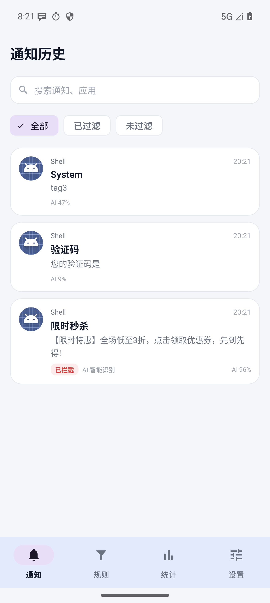 | 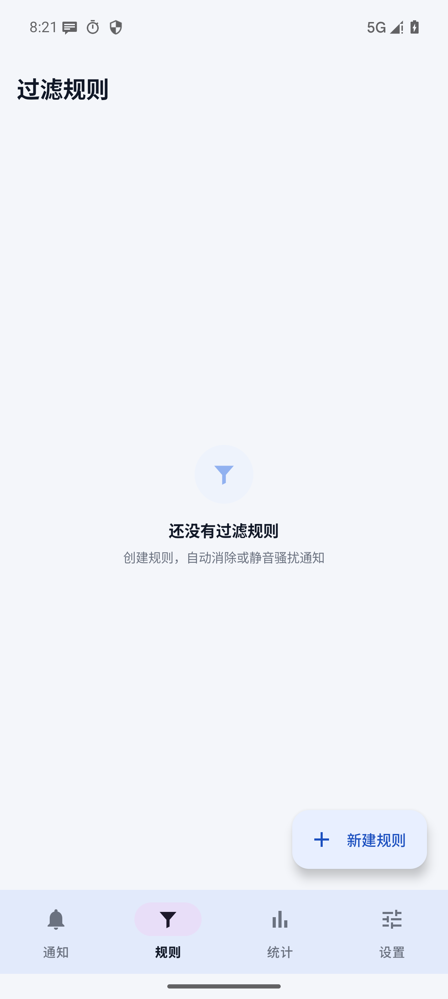 | 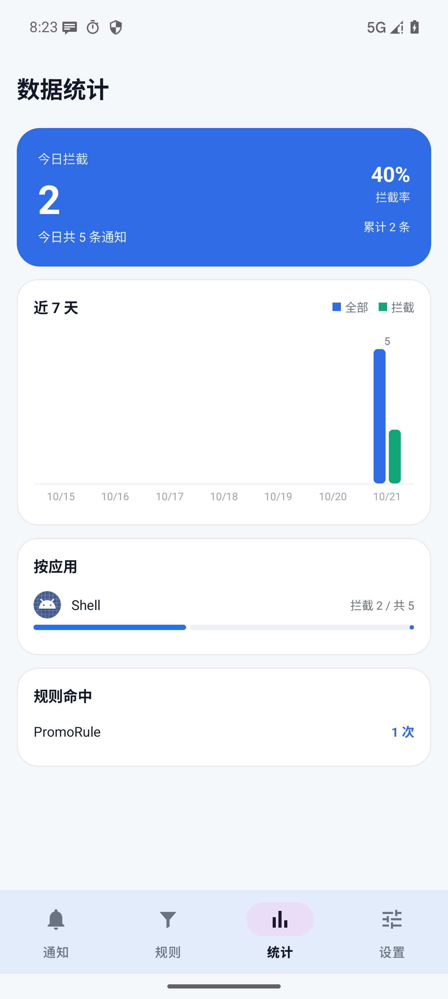 | 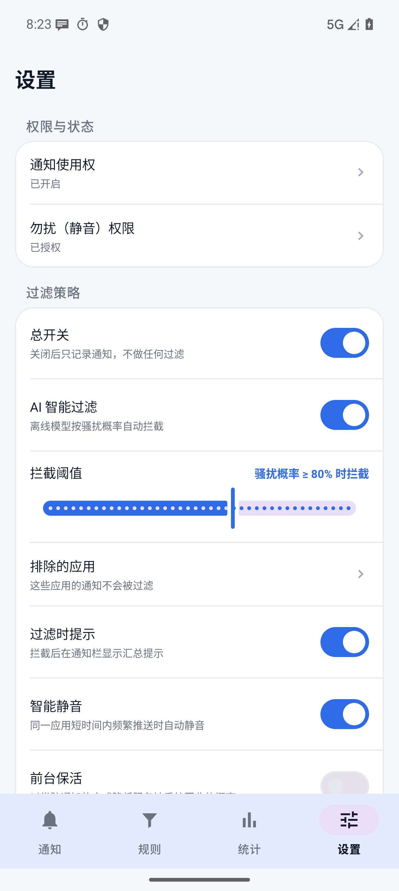 |

## 构建

要求 JDK 17、Android SDK 36。

```bash
./gradlew :app:assembleDebug
```

产物：`app/build/outputs/apk/debug/app-debug.apk`

安装后：

1. 打开应用，点「去授权」，在系统列表中勾选「通知哨兵」。
2. Android 13+ 允许通知权限（用于「已过滤 N 条」提示）。
3. 如需「静音」效果：设置 → 勿扰（静音）权限 → 允许。

## Webhook 转发怎么用

1. 规则页 →「新建规则」，选择过滤范围（全部应用 / 仅指定应用）。
2. 匹配方式选「包含任一关键词」（按内容转发）或「所有通知（不筛选文本）」（无条件转发）。
3. 打开「转发到 Webhook」，填写地址与 POST Body 模板，保存即可；命中时在独立线程异步发送。

默认 Body：

```json
{
  "app": "{app}",
  "package": "{package}",
  "title": "{title}",
  "message": "{message}",
  "channel": "{channel}",
  "when": {when}
}
```

支持 http/https（含 `127.0.0.1`、局域网地址），规则编辑页可直接「发送测试」。

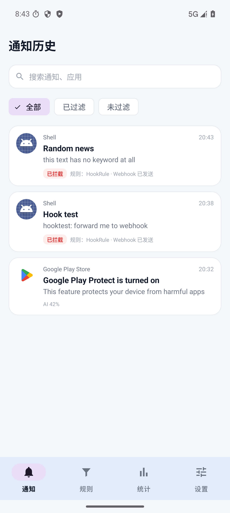

## Bark 推送（iOS）

1. 设置 →「Bark 推送」：填写服务器（默认 `https://api.day.app`）和 Bark App 首页的 **Device Key**，可选分组与通知级别。
2. 需要隐私保护时打开「加密推送」，填写与 Bark App「推送加密」中一致的密钥：
   - 16 位 → AES-128，24 位 → AES-192，32 位 → AES-256（仅 ASCII）；
   - 加密后只上送 `ciphertext` + 随机 `iv`，Bark 服务器与 APNs 都无法看到内容；
   - 密钥不匹配时不会降级为明文，直接报错。
3. 规则编辑页打开「推送到 Bark」；可用设置页的「发送测试推送」先验证配置。

| Bark 配置（加密已开启） | 推送后的历史记录 |
| --- | --- |
| 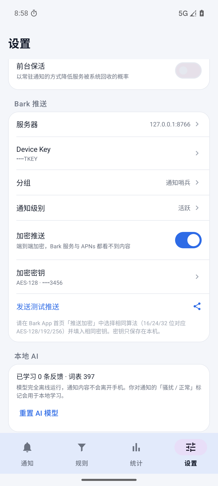 | 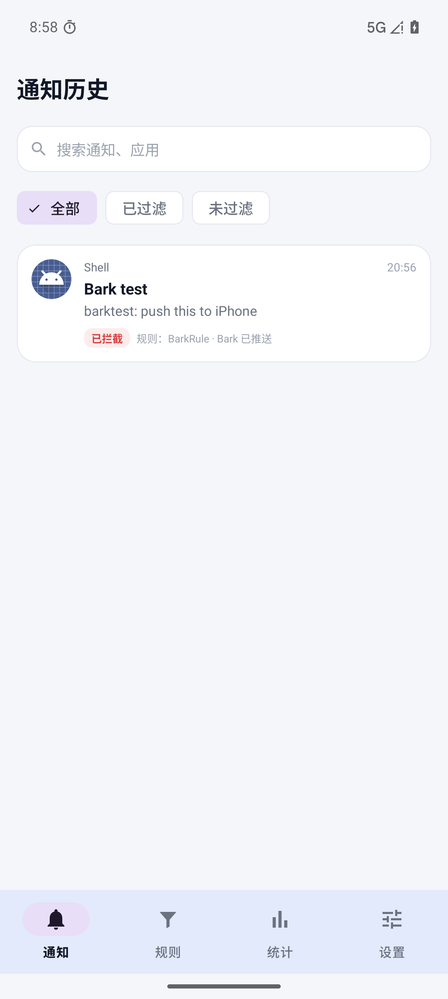 |

## 后台保活

- **进程隔离**：通知监听、保活、看门狗运行在 `:service` 进程，杀掉 UI 进程不影响过滤；配置与 AI 模型用 **MMKV 多进程模式**共享，数据库开启 **WAL**。
- **specialUse 前台服务**：常驻通知 + `START_STICKY`，不受 Android 15 对 dataSync 类型的 6 小时限制。
- **自动重启**：从最近任务划掉或服务被销毁后，用 AlarmManager 1–2.5 秒后重新拉起。
- **看门狗**：JobScheduler 每 15 分钟检查一次，服务不在就拉起、通知监听断开就请求重新绑定（重启后仍有效）。
- **断链恢复**：监听断开后按 1s/3s/10s/30s/60s 退避重连，最终失败弹「通知访问已断开」提醒。
- **系统限制**：设置页可查看/请求忽略电池优化，并提供最近任务加锁、自启动、后台限制的保活指南。

> 与参考应用一致，监听服务放在独立 `:service` 进程，用 MMKV 做多进程配置/模型共享；`ps` 中可看到 `com.notifyforward.app` 和 `com.notifyforward.app:service` 两个进程。

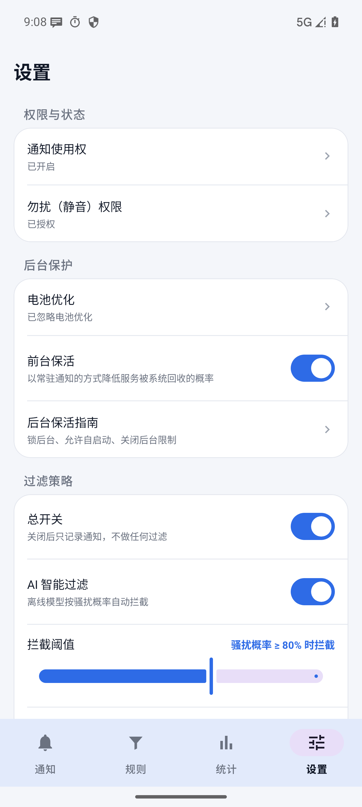

实测：`kill -9` 杀掉进程后 8 秒内服务自动恢复（新 PID、specialUse 前台状态），随后投递的通知仍能正常入库。

## 微信分身 / 多开

分身通知能不能被读到，取决于分身是怎么实现的 —— `NotificationListenerService` 的投递范围由系统按「用户 + uid」分发：

| 分身类型 | 通知的包名 / uid | 能否收到 |
| --- | --- | --- |
| 系统分身（小米 / 华为 / OPPO / vivo 等） | 原包名（`com.tencent.mm`）+ 独立 uid | **由 ROM 决定**：多数机型把分身放在独立用户空间，不把通知转投给主空间的第三方监听器；少数 ROM 会桥接 |
| 第三方双开（平行空间 / 双开助手等） | 宿主包名，或原包名 + 宿主 uid | 多数能收到，可能显示为宿主应用名，规则要按宿主包名配置 |
| 工作资料 / 多用户 | 独立 `userId` | 默认收不到（监听器未在该用户下授权） |

**只要通知能到达监听器，转发就完全正常**：规则按包名匹配，Webhook 与 Bark 都不区分主应用和分身。收到分身通知时：

- 入库记录真实 `uid`、`user_id`，同包名但 uid 与主应用不同 → 判定为分身；
- 历史列表显示「微信（分身）」并标注「分身通知」，详情显示 `分身 · uid 1010234`；统计按「包名 + 是否分身」分组，主/分身分开计数；
- Webhook 支持 `{uid}`、`{user}`、`{clone}` 变量，默认 Body 已带 `uid` 与 `clone`；Bark 的 subtitle 自动加「（分身）」；
- 设置 →「分身通知检测」列出每个应用收到过的 uid：出现两个 uid 就说明系统确实在投递。

如果检测结果里只有一个 uid，说明你的机型把分身放在独立用户空间、系统不做桥接，这是系统限制，非 root 应用无法绕过。

| 分身历史 | 分身详情 | 分身检测 |
| --- | --- | --- |
| 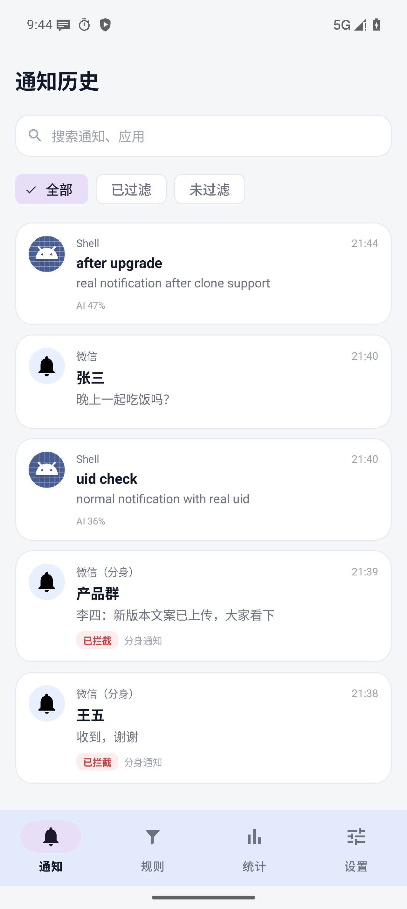 | 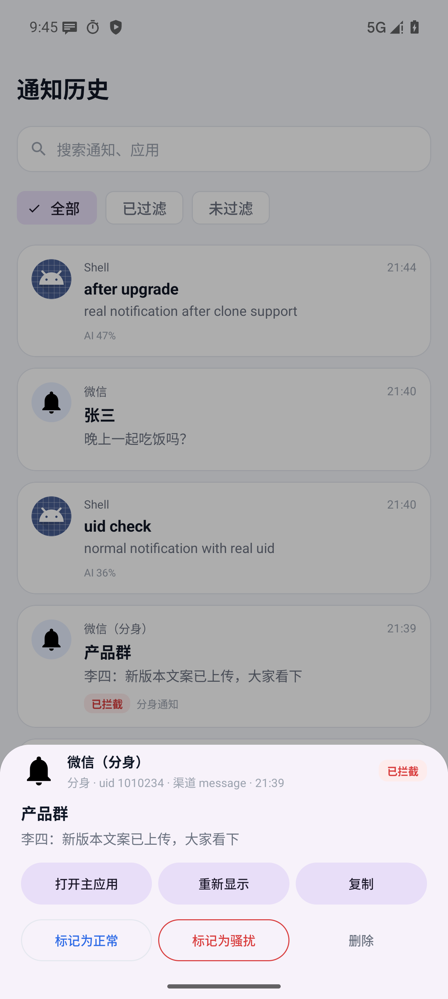 | 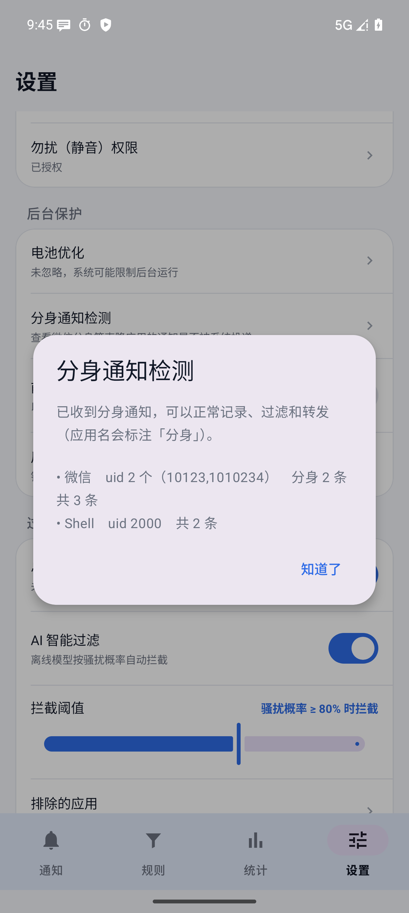 |

## 技术要点

- `NotificationListenerService` 串行处理通知，避免并发写库。
- 规则引擎是纯函数，同一套逻辑既用于实时过滤，也用于「在历史中测试命中」。
- 静音使用 `NotificationManager.setInterruptionFilter`，到期自动恢复，并在进程被杀后兜底恢复。
- AI 模型以 JSON 存于 MMKV（带版本号，多进程可见），分词支持中文单字/二元组与英文单词，评分按 token 数归一化以避免文档长度漂移。
- 网络与数据库不引第三方库：`HttpURLConnection` + `SQLiteOpenHelper`（WAL）；仅设置与 AI 模型使用 MMKV 做多进程共享。安装包约 11 MB（含 MMKV 四种 ABI）。

## 目录

```
app/src/main/java/com/notifyforward/app/
├── data/      SQLite、设置、进程内事件
├── engine/    规则、AI、Webhook、勿扰、TTS
├── model/     通知与规则数据模型
├── service/   通知监听、前台保活、开机自启
├── ui/        历史 / 规则 / 统计 / 设置 / 规则编辑
└── util/      应用信息、系统通知、CSV、规则导入导出
```

## 已知限制

- Android 15+ 系统会阻止第三方读取疑似含验证码的通知，同类应用均无法绕过。
- 静音效果依赖勿扰权限；未授权时只有「消除」生效。
- 国产 ROM 需自行允许自启/关闭电池优化，或开启「前台保活」。
- 未实现参考应用的订阅计费、桌面小组件、快捷磁贴、来电式提醒、验证码复制按钮等扩展能力。
