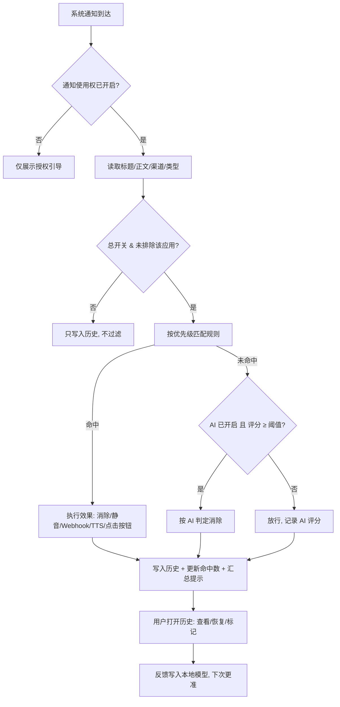

# 参考应用解析与本地实现说明

本文档记录对 `a.apk` 的逆向分析结论，以及本项目（NotifyForward / 通知哨兵）如何用 Android 原生技术复刻其用途与交互。

---

## 一、分析方式

| 项目 | 说明 |
| --- | --- |
| 样本 | `a.apk`，75,014,265 字节（约 72 MB） |
| 清单解析 | 自定义 AXML 解析 + androguard 读取组件、权限、meta-data |
| 资源解析 | 直接解析 `resources.arsc` 字符串池（资源名与类名均被混淆，字符串值保留） |
| 代码结构 | 解析 `classes.dex` / `classes2.dex` 的类名、字符串常量 |
| 运行验证 | Android 16（API 36）模拟器，逐屏截图与数据库核对 |

> 说明：样本经 R8 混淆，应用类名被压缩为 `com.catchingnow.np.E$W` 这类形式，资源文件名也被缩短（`res/-B.xml`）。因此功能判断以**清单组件 + 资源文案 + 字符串常量 + 资源文件**四类证据交叉确认，不依赖不可读的类名。

---

## 二、应用画像

| 属性 | 值 |
| --- | --- |
| 应用名 | FilterBox（中文名：通知滤盒） |
| 包名 | `com.catchingnow.np` |
| 版本 | 3.4.5（versionCode 203053733） |
| minSdk / targetSdk | 22 / 36 |
| 体积构成 | `model_b.tflite` 40 MB、`libtensorflowlite_flex_jni.so` 68 MB（未压缩）、`model.tflite` 2.5 MB、`vocab.txt` 78 KB |
| 主要技术栈 | Kotlin/Java、Room、WorkManager、MMKV、TensorFlow Lite、Play Billing 7.1.1、Firebase Analytics/Crashlytics |
| 进程结构 | 主进程 + `:Service` 进程（监听、保活、RemoteViews 独立进程） |

**一句话定位**：读取系统通知 → 用规则与本地 AI 判断 → 自动消除/静音/转发 → 留下可检索、可恢复、可统计的通知历史。

---

## 三、核心功能地图

### 1. 通知监听与记录
- 声明 `NotificationListenerService`（`E$V`，`BIND_NOTIFICATION_LISTENER_SERVICE`，运行在 `:Service` 进程）。
- 读取标题、正文、大文本、子文本、渠道、分组、category、是否常驻、是否可清除。
- 缓存最近 10 条通知的完整调试字段，供高级规则、Webhook 变量、TTS 使用。
- 额外读取 `StatusBarNotification.uid` 与 `userId`：同包名但 uid 与主应用不一致时判定为**分身/克隆实例**，用于区分「微信」与「微信分身」。

### 2. 规则引擎（核心）
从字符串资源可还原出完整的规则模型：

- **过滤范围**：所有应用 / 仅指定应用 / 排除指定应用。
- **文本匹配**：包含全部、包含任一、不含任一、不含全部、正则匹配、高级匹配（JSON + 正则遍历任意字段）。
- **类型豁免**：常驻通知、媒体通知、对话通知（短信除外）、MIUI 焦点通知。
- **规则效果**（可组合）：
  - 消除（直接从通知栏移除）
  - 静音（勿扰压制铃声/振动）
  - 延时消除
  - 更改铃声 / 振动 / 勿扰
  - Webhook（JSON POST 到自定义地址，支持 `{app}`、`{title}`、`{message}`、`{filterbox.field.PACKAGE_NAME}` 等变量）
  - 模拟点击通知按钮（如「已读」「归档」）
  - 朗读通知内容（TTS）
  - 来电式提醒 / 替换通知内容
- **规则管理**：启用开关、按过滤数量排序、规则测试（在历史中回放命中数）、复制、删除、JSON 导入/导出/分享。

### 3. 后台保活（参考实现 vs 本项目）

参考 APK 的做法（清单证据）：

| 机制 | 参考应用 |
| --- | --- |
| 监听服务进程 | `android:process=":Service"`，与 UI 进程隔离 |
| 前台服务类型 | 监听服务与保活服务都声明 `foregroundServiceType="0x40000000"`（**specialUse**） |
| 开机自启 | `BOOT_COMPLETED` 接收器也放在 `:Service` 进程 |
| 用户引导 | 设置项「以前台服务方式保活」；提示关闭电池优化、允许自启动、最近任务加锁；断链时提示「关闭通知访问再重新打开」 |
| 权限 | `FOREGROUND_SERVICE`、`FOREGROUND_SERVICE_SPECIAL_USE`、`RECEIVE_BOOT_COMPLETED`、`WAKE_LOCK` |
| 设置存储 | MMKV（支持多进程），因此 UI 进程与 `:Service` 进程能共享配置 |

本项目采用同等级别的保活策略，并按参考应用拆分了独立进程：

| 机制 | 本项目实现 |
| --- | --- |
| 进程隔离 | 监听/保活/看门狗/重启接收器运行在 `:service` 进程，UI 在默认进程；杀掉 UI 进程不影响过滤 |
| 配置共享 | 设置层换成 **MMKV MULTI_PROCESS_MODE**（首次启动自动迁移旧 SharedPreferences），跨进程读写实时可见 |
| AI 模型 | 模型 JSON 存入 MMKV 并带版本号，另一进程评分时按版本自动重载，避免多进程下模型陈旧 |
| 数据刷新 | 进程内 SharedFlow 改为**应用内显式广播**，`:service` 写完库后通知 UI 刷新 |
| 数据库 | SQLite 开启 **WAL** + `busy_timeout=5s`，支持两个进程并发读写 |
| 前台服务类型 | `specialUse`（避免 Android 15 对 dataSync 的 6 小时限制），常驻通知 |
| 服务重启 | `START_STICKY`；`onTaskRemoved` / `onDestroy` 通过 AlarmManager 1–2.5 秒后再次拉起 |
| 看门狗 | `JobScheduler` 每 15 分钟检查：保活服务不在则拉起、监听未连接则 `requestRebind`（`setPersisted` 重启后仍有效） |
| 开机自启 | `BOOT_COMPLETED` 启动保活服务并注册看门狗 |
| 断链恢复 | 1s / 3s / 10s / 30s / 60s 退避重连；最终失败发「通知访问已断开」提醒，点击直达授权页 |
| 电池优化 | 设置页显示状态并可一键请求忽略（`REQUEST_IGNORE_BATTERY_OPTIMIZATIONS`），另附「后台保活指南」（最近任务加锁、自启动、后台限制） |

> 参考应用用 MMKV 支撑 `:Service` 多进程，本项目采用同样方案；区别是配置键与模型存储为本项目自建，且额外加了 AI 模型版本号与 WAL 并发设置。

### 4. 本地 AI 过滤
- 内置 TFLite 文本分类模型（`assets/model.tflite` + `vocab.txt`），另有大模型 `model_b.tflite` 通过 Play 下载。
- 输出「骚扰指数」，按阈值（≥ N%）自动拦截；界面展示拦截时指数与当前指数。
- 用户可对历史通知「投喂」：标记骚扰 / 正常，模型在手机闲置时训练，逐步贴合个人习惯。
- 多次把某应用标记为正常后，会建议不再过滤该应用。
- 全程离线，通知内容不上传（「分享 AI 数据到云端」默认关闭）。

### 5. 通知历史
- 本地数据库（Room）保存通知，保留期 7 / 30 / 90 天可配。
- 支持按应用、状态、关键词检索；被过滤、隐藏、未过滤分开展示。
- 通知详情：查看全文、打开原应用、恢复显示、标记反馈。
- 导出 CSV（Excel / Google Sheet 可读）。

### 6. 通知增强
- 验证码复制按钮；锁屏时把验证码替换为 `***`。
- 通知朗读（TTS）。
- 来电式全屏提醒（`E$K`，`showOnLockScreen` + `turnScreenOn`）。
- 音乐通知专辑卡片。

### 7. 集成与系统入口
- Webhook 转发、Clip Cloud 验证码跨设备同步、Inputting+ 联动。
- 快捷设置磁贴（`E$I`，`BIND_QUICK_SETTINGS_TILE`）。
- 4 个桌面小组件（`E$AA`、`E$AB`、`E$QA`、`E$Q` + RemoteViews 服务 `E$J`）。
- 勿扰自动规则 Activity（`E$C`，`android.service.zen.automatic.ruleType`）。
- 前台服务保活、开机自启、从最近任务隐藏、生物识别锁。

### 8. 商业化与合规
- Google Play 订阅（Billing 7.1.1）+ 支付宝/微信订单号兑换。
- Pro 权益：更长历史、部分高级效果。
- 隐私政策、ICP 备案、多语言（中/英/日/德/法/西/葡等）。

### 9. 权限清单（关键项）
`POST_NOTIFICATIONS`、`ACCESS_NOTIFICATION_POLICY`（勿扰）、`EXPAND_STATUS_BAR`、
`FOREGROUND_SERVICE`(+`DATA_SYNC`/`SPECIAL_USE`)、`RECEIVE_BOOT_COMPLETED`、
`SYSTEM_ALERT_WINDOW`、`USE_BIOMETRIC`/`USE_FINGERPRINT`、`QUERY_ALL_PACKAGES`、
`INTERNET`、`com.android.vending.BILLING`。

### 10. 分身与多用户通知

`NotificationListenerService` 的投递范围由系统按「用户 + uid」分发，因此分身能不能被读到，取决于分身用哪种方案实现：

| 分身实现 | 通知的包名 / uid | 主空间监听器能否收到 |
| --- | --- | --- |
| 系统分身（小米/华为/OPPO/vivo 等） | 原包名（`com.tencent.mm`）+ 独立 uid（多用户/克隆空间） | **由 ROM 决定**。多数机型把分身放在独立用户，系统不把该用户的通知转投给主空间监听器；少数 ROM 会桥接 |
| 第三方双开（平行空间、双开助手等） | 宿主包名，或原包名 + 宿主 uid（VirtualApp 类方案） | 多数能收到，但可能显示为宿主应用名，规则需按宿主包名配置 |
| 工作资料 / 多用户 | 独立 `userId` | 默认收不到（监听器未在该用户下授权） |

只要通知能到达监听器，**转发链路与来源无关**：规则按包名匹配，Webhook 与 Bark 照常发送。

本项目的处理：

- 入库时保存 `uid`、`user_id`，并用「包名对应的主应用 uid」对比，得到 `is_clone`；
- 历史列表显示「微信（分身）」并在副标题标注「分身通知」，详情显示 `分身 · uid 1010234`；统计按 `package + is_clone` 分组，主/分身分开计数；
- Webhook 支持 `{uid}`、`{user}`、`{clone}` 变量，默认 Body 已带 `uid` 与 `clone`；Bark 的 `subtitle` 带「（分身）」；
- 设置 →「分身通知检测」按包名列出收到过的 uid：出现两个 uid 即说明系统确实在投递。

已知边界：`cancelNotification` 对分身同样有效（按 `key` 取消，key 内已含 uid）；但「打开应用」只能拉起主应用，分身需从桌面图标进入。

---

## 四、关键交互流程



首次使用链路：启动 → 引导授予通知使用权 → 授予通知权限（Android 13+）→ 可选授予勿扰权限 → 返回应用看到「已连接」。

---

## 五、本地项目的模块映射

| 参考能力 | 本项目实现 | 说明 |
| --- | --- | --- |
| 通知监听服务 | `service/NotifyListenerService.kt` | 同款 `NotificationListenerService`，单线程串行处理，忽略自身包名 |
| 通知数据模型 | `model/NotifRecord.kt` | 标题/正文/大文本/渠道/分组/category/常驻/可清除/会话/媒体 |
| 规则模型 | `model/FilterRule.kt` | 范围、5 种匹配、类型豁免、效果组合、命中数、JSON 序列化 |
| 规则判定 | `engine/RuleEngine.kt` | 纯函数，可在历史记录上回放，用于「测试命中」 |
| 规则编辑 | `ui/RuleEditActivity.kt` + `ui/rules/AppPickerDialog.kt` | 表单化编辑、应用多选、正则校验、Webhook 测试 |
| 本地 AI | `engine/AiEngine.kt` | 朴素贝叶斯 + 营销/验证码规则先验；模型 JSON 存 MMKV（多进程 + 版本号），反馈在线学习 |
| 历史存储 | `data/DbHelper.kt` | SQLite（`notifications`、`rules` 两张表 + 索引），WAL 模式支持双进程并发 |
| 历史界面 | `ui/history/*` | 列表、搜索、状态筛选、详情弹层、恢复、反馈 |
| 消除/静音 | `NotifyListenerService` + `engine/DndController.kt` | 消除调用 `cancelNotification`；静音用勿扰策略并自动恢复 |
| Webhook | `engine/WebhookClient.kt` | `HttpURLConnection` POST JSON，变量替换与 URL 编码 |
| 朗读 | `engine/TtsSpeaker.kt` | 系统 TTS，按规则触发 |
| 过滤汇总提示 | `util/Notices.kt` | 低优先级渠道的「已过滤 N 条」通知 |
| 统计 | `ui/stats/StatsFragment.kt` + `ui/widget/WeekBarChart.kt` | 今日/累计/拦截率、7 天双柱图、按应用、规则命中 |
| 设置 | `ui/settings/SettingsFragment.kt` | 权限状态、总开关、AI 阈值、排除应用、保留期、CSV、规则导入导出、保活 |
| 保活 | `service/KeepAliveService.kt` + `service/WatchdogService.kt` + `service/RestartReceiver.kt` + `BootReceiver.kt` | specialUse 前台服务、START_STICKY、任务移除/销毁后闹钟重启、15 分钟 JobScheduler 看门狗、开机自启、通知监听退避重连与断链提醒、电池优化授权入口 |
| 数据变更通知 | `data/DataEvents.kt` | 应用内显式广播，`:service` 写库后通知 UI 刷新（跨进程） |

### 目录结构

```
app/src/main/java/com/notifyforward/app/
├── NotifyApp.kt
├── data/        DbHelper · Settings · DataEvents
├── engine/      RuleEngine · AiEngine · WebhookClient · DndController · TtsSpeaker
├── model/       FilterRule · NotifRecord
├── service/     NotifyListenerService · KeepAliveService · BootReceiver
├── ui/          MainActivity · RuleEditActivity
│   ├── history/   HistoryFragment · HistoryAdapter · NotificationDetailSheet
│   ├── rules/     RulesFragment · RuleAdapter · AppPickerDialog
│   ├── stats/     StatsFragment
│   ├── settings/  SettingsFragment
│   └── widget/    WeekBarChart
└── util/        AppInfo · Notices · CsvExporter · RuleIO
```

---

## 六、功能对齐与差异

### 已对齐（用途与体验一致）

| 能力 | 状态 |
| --- | --- |
| 通知读取与本地历史 | ✅ 标题、正文、渠道、时间、应用、类型 |
| 规则匹配 | ✅ 任一/全部/不含/正则/高级 JSON 字段正则/全部通知（无条件） |
| 过滤范围 | ✅ 全部 / 仅指定 / 排除指定（应用多选） |
| 类型豁免 | ✅ 常驻、媒体、对话/邮件 |
| 效果：消除 | ✅ 直接移除并记录 |
| 效果：静音 | ✅ 勿扰压制，自动恢复（需勿扰权限） |
| 效果：Webhook | ✅ JSON POST，变量替换，独立线程异步发送，支持 http/https（含局域网/本机地址） |
| 效果：Bark 推送 | ✅ Device Key / 自定义服务器 / 分组 / 级别；支持 Bark 官方端到端加密（AES-CBC + 随机 IV，仅上送 ciphertext/iv） |
| 效果：TTS 朗读 | ✅ 规则级开关 |
| 效果：点击通知按钮 | ✅ 按按钮名匹配并触发 PendingIntent |
| 本地 AI | ✅ 离线评分、阈值、反馈学习、排除建议 |
| 智能静音 | ✅ 高频推送自动静音（阈值/窗口/时长可配） |
| 历史管理 | ✅ 搜索、筛选、详情、恢复、删除、CSV |
| 规则管理 | ✅ 启停、复制、删除、测试命中、JSON 导入导出分享 |
| 统计 | ✅ 今日/累计/拦截率、7 天趋势、按应用、规则命中 |
| 设置 | ✅ 权限引导、总开关、排除应用、保留期、保活、汇总提示 |

### 有意差异（受实现范围限制）

| 参考能力 | 本项目做法 |
| --- | --- |
| TFLite 预训练模型（含 40 MB 大模型） | 改为**本地朴素贝叶斯 + 规则先验**，内置小语料冷启动，体积从 42 MB 降到可忽略；语义上仍是「离线打分 + 反馈学习 + 阈值拦截」 |
| Google Play 订阅 / 订单号兑换 | 未实现，全部功能免费（无支付、无 Pro 门禁） |
| 桌面小组件 / 快捷设置磁贴 / 勿扰自动规则 | 未实现 |
| 来电式全屏提醒 / 音乐专辑卡片 | 未实现 |
| 验证码复制按钮、锁屏打码 | 未实现（系统级增强，依赖无障碍/悬浮窗） |
| 生物识别锁、从最近任务隐藏 | 未实现 |
| 多语言 | 仅简体中文（资源预留英文） |
| 数据库加密 | 未实现，数据仅存于应用私有目录 |

> 结论：**过滤、AI 判定、历史、规则、Webhook、统计这六条主链路与参考应用用途一致**；差异集中在商业化和系统级扩展入口。

---

## 七、构建与验证

### 环境
- JDK 17，Android SDK Platform 36，Build-Tools 36
- AGP 8.13.0，Kotlin 2.2.0，Gradle 8.14.2（已带 Wrapper）

### 构建
```bash
./gradlew :app:assembleDebug
# 产物：app/build/outputs/apk/debug/app-debug.apk（约 11 MB，含 MMKV 四种 ABI）
```

### 安装与授权
```bash
adb install -r app/build/outputs/apk/debug/app-debug.apk
# 打开应用 →「去授权」→ 勾选「通知哨兵」
# 如需静音效果：设置 → 勿扰（静音）权限 → 允许
```

### 实测结果（Android 16 / API 36 模拟器）

| 用例 | 结果 |
| --- | --- |
| 营销通知「【限时特惠】全场低至3折…」 | AI 96%，自动消除，历史标记「已拦截 / AI 智能识别」 |
| 验证码「您的验证码是 384756…」 | AI 9%，正常放行 |
| 系统更新文案「Checking for system and security updates」 | AI 47%，放行（此前模型漂移误判 80%，已修正） |
| 新建规则 PromoRule（关键词 sale） | 命中后消除，历史显示「规则：PromoRule」，规则命中数 +1 |
| 统计页 | 今日 5 条 / 拦截 2 条 / 40%，7 天柱图、按应用、规则命中均正确 |
| Webhook 转发 | 规则 `HookRule`（关键词 hooktest）命中后，本机 HTTP 服务收到 `POST /hook`，JSON 含 app/package/title/message/channel/when；记录 `action=5`（消除 + 转发），规则命中数 +1 |
| 无条件转发 | 规则切换为「所有通知（不筛选文本）」后，不含关键词的通知同样被转发（服务端收到第二条 POST），历史显示「规则：HookRule · Webhook 已发送」；保存时会对「拦截全部通知」二次确认 |
| Bark 加密推送 | 配置 `http://127.0.0.1:8766` + Device Key + 16 位密钥后发送测试：服务端只收到 `ciphertext` 与随机 `iv`，用同一密钥 AES-128-CBC 解出完整 JSON（title/subtitle/body/group/level/isArchive）；规则触发同样成功，记录 `action=17`（消除 + Bark） |
| Bark 真实设备 | 使用真实 Device Key 调用 `https://api.day.app/<key>` 返回 `{"code":200,"message":"success"}`；应用内「发送测试推送」走同一链路 |
| 保活 | 开启前台保活后，`dumpsys activity services` 显示 `KeepAliveService isForeground=true types=0x40000000`（specialUse），`dumpsys jobscheduler` 显示 `JOB #.../1001 PERIODIC 15m PERSISTED`；`kill -9` 进程后 8 秒内自动拉起新进程并恢复前台服务，随后投递的通知仍能正常入库与过滤 |
| 多进程 | `ps -A` 同时存在 `com.notifyforward.app` 与 `com.notifyforward.app:service`；杀掉 UI 进程后 `:service` 仍在，后续通知继续被 AI 过滤（`action=1`）；杀掉 `:service` 后 10 秒内自动重启（新 PID），`KeepAliveService` 恢复 `isForeground=true / types=0x40000000` |
| 界面跟随 | 新通知经跨进程广播写入列表；用户位于列表顶部时自动滚动到最新一条，浏览旧记录时不打断 |
| 跨进程配置 | 在 UI 关闭总开关后，服务只入库不过滤（`action=0`）；重新打开后恢复过滤（`action=1`）。AI 阈值从 80% 调到 99% 后，94% 的营销通知不再被拦截，说明 `:service` 实时读到了 MMKV 配置 |
| 通知列表实时刷新 | 过滤后无需手动刷新即出现在列表 |
| 分身识别 | 用「同包名 + 不同 uid」样本验证：列表显示「微信（分身）」并标注「分身通知」，详情显示 `分身 · uid 1010234`，统计把「微信（分身）」与「微信」分成两行；设置里的「分身通知检测」列出 `微信 uid 2 个（10123,1010234） 分身 2 条` |

截图见 `docs/screenshots/`。

### 已知限制
1. **Android 15+ 敏感通知**：系统会阻止第三方读取疑似含验证码的通知，任何同类应用都无法绕过。
2. **静音依赖勿扰权限**：未授权时该效果降级为不执行（规则里的「消除」不受影响）。
3. **国产 ROM 后台限制**：建议手动允许自启/关闭电池优化，或开启「前台保活」。
4. **旁加载受限设置**：部分系统需在应用信息页允许「受限设置」后才能勾选通知使用权。
5. **Webhook 明文 HTTP**：为兼容局域网/本机自建服务，清单开启了 `usesCleartextTraffic`；若你的接收端固定使用 HTTPS，可去掉该属性收紧密文策略。
6. **加密范围**：Bark 加密只保护「转发出去的内容」；本地通知历史仍以应用私有目录下的 SQLite 明文保存（不对外暴露）。如需本地数据库加密，需要额外引入 SQLCipher 或字段级加密。
7. **分身通知的可见性由系统决定**：分身跑在独立用户空间时，主空间的监听器收不到，本项目只能如实提示（设置页「分身通知检测」），无法绕过；规则目前按包名匹配，主应用与分身共用同一条规则。

---

## 八、后续可扩展

- 引入 TFLite 小模型替换/增强当前贝叶斯分类器（接口已隔离在 `AiEngine`）。
- 增加快捷设置磁贴与桌面小组件（复用现有统计查询）。
- 增加通知摘要（同应用多条合并）与按渠道规则。
- 规则条件扩展到「应用安装来源」「通知优先级」等字段。
